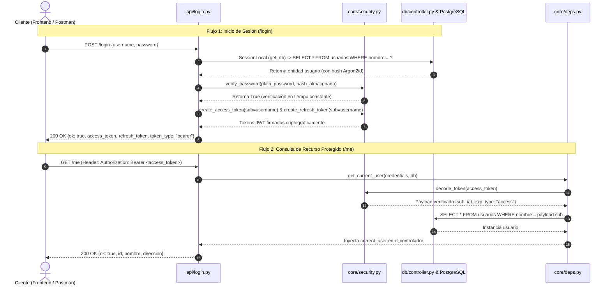
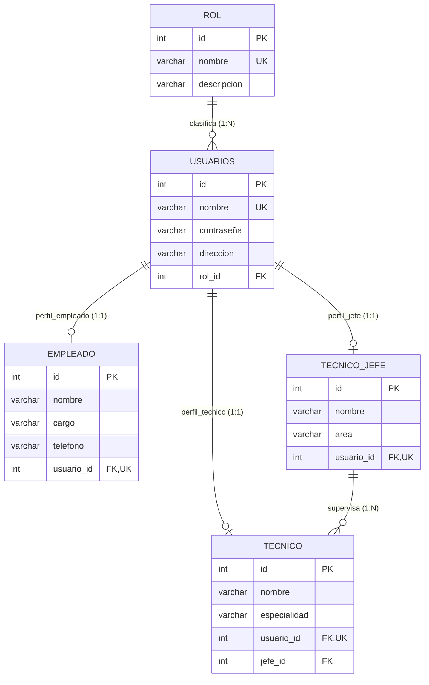

# Documentación Técnica: Arquitectura, Flujo de Funcionamiento y Modelo de Datos

> **Proyecto:** CFS-Admin (Backend)  
> **Tecnologías Centrales:** Python 3.14, FastAPI, SQLAlchemy 2.0, PostgreSQL, PyJWT, Argon2id, Pydantic V2  
> **Fecha:** Octubre 2026  

---

## 1. Visión General del Sistema

El backend de **CFS-Admin** es una API REST modular construida sobre **FastAPI** orientada a la administración y monitoreo de servicios técnicos. Su diseño desacopla la configuración del entorno, la lógica criptográfica de autenticación, el acceso a datos mediante **SQLAlchemy** y los controladores de endpoints HTTP.

---

## 2. Flujo de Funcionamiento del Sistema

### 2.1. Diagrama de Secuencia: Autenticación y Acceso a Recursos Protegidos

---

## 3. Descripción Detallada Paso a Paso: Módulos, Funciones y Paquetes

A continuación se detalla cada componente del software, los paquetes externos utilizados, las funciones involucradas y su propósito en la arquitectura:

### 3.1. Arranque y Configuración del Sistema

| Módulo / Archivo | Paquetes Usados | Función / Clase | ¿Qué hace y cómo ayuda al programa? |
| :--- | :--- | :--- | :--- |
| [`config/load.py`](file:///home/nesantime/Universidad/cfs-admin/backend/config/load.py) | `pydantic-settings`, `dotenv` | Clase `_Config(BaseSettings)` | Carga las variables de entorno desde `.env` con tipado estricto (puerto, base de datos, CORS, JWT). Evita variables nulas en tiempo de ejecución. |
| [`config/load.py`](file:///home/nesantime/Universidad/cfs-admin/backend/config/load.py) | `pydantic` | `validate_jwt_secret()` | Validador `@field_validator` que aborta el inicio del servidor si `JWT_SECRET_KEY` está vacía o tiene menos de 32 caracteres (256 bits), garantizando criptografía fuerte antes de recibir peticiones. |
| [`core/app.py`](file:///home/nesantime/Universidad/cfs-admin/backend/core/app.py) | `fastapi`, `starlette` | `FastAPI(...)`, `add_middleware(CORSMiddleware)` | Inicializa la aplicación web, inyecta las políticas de CORS e importa tempranamente `db.template` para registrar todos los mappers de SQLAlchemy. |
| [`cfs-admin.py`](file:///home/nesantime/Universidad/cfs-admin/backend/cfs-admin.py) | `argparse`, `uvicorn`, `subprocess` | `main()` | CLI principal del proyecto. Permite levantar PostgreSQL con Docker Compose (`run db`), iniciar la API (`run app`) o inicializar el esquema de tablas (`create db`). |

---

### 3.2. Capa de Persistencia y Base de Datos

| Módulo / Archivo | Paquetes Usados | Función / Clase | ¿Qué hace y cómo ayuda al programa? |
| :--- | :--- | :--- | :--- |
| [`db/connect.py`](file:///home/nesantime/Universidad/cfs-admin/backend/db/connect.py) | `sqlalchemy.orm` | Clase `Base(DeclarativeBase)` | Provee la metadata central y el registro común donde se registran todas las tablas y relaciones del ORM. |
| [`db/controller.py`](file:///home/nesantime/Universidad/cfs-admin/backend/db/controller.py) | `sqlalchemy`, `psycopg` | `engine`, `SessionLocal` | Configura el pool de conexiones hacia PostgreSQL con reconexión activa (`pool_pre_ping=True`). |
| [`db/controller.py`](file:///home/nesantime/Universidad/cfs-admin/backend/db/controller.py) | `typing` | `get_db()` | Generador dependiente de FastAPI (`yield db`). Abre una sesión por petición HTTP y asegura su cierre (`db.close()`) en el bloque `finally`, evitando fugas de conexiones. |
| [`db/controller.py`](file:///home/nesantime/Universidad/cfs-admin/backend/db/controller.py) | `sqlalchemy.inspect` | `create_tables()` | Importa todos los modelos, invoca `Base.metadata.create_all(bind=engine)` para crear tablas en orden de dependencias FK e inspecciona e imprime las tablas creadas. |
| [`db/template/__init__.py`](file:///home/nesantime/Universidad/cfs-admin/backend/db/template/__init__.py) | Interno | Paquete `db.template` | Importa explícitamente `rol`, `usuario`, `tecnicojefe`, `tecnico` y `empleado`. Resuelve de forma anticipada las referencias entre clases, eliminando los errores de mapeo circular en SQLAlchemy. |

---

### 3.3. Capa de Seguridad y Criptografía

| Módulo / Archivo | Paquetes Usados | Función / Clase | ¿Qué hace y cómo ayuda al programa? |
| :--- | :--- | :--- | :--- |
| [`core/security.py`](file:///home/nesantime/Universidad/cfs-admin/backend/core/security.py) | `pwdlib[argon2]`, `argon2-cffi` | `hash_password(password)` | Transforma una contraseña en plano en un hash irreversible con algoritmo **Argon2id**, resistente a ataques mediante GPUs y tablas arcoíris. |
| [`core/security.py`](file:///home/nesantime/Universidad/cfs-admin/backend/core/security.py) | `pwdlib` | `verify_password(plain, hashed)` | Realiza la comparación criptográfica en **tiempo constante**, previniendo ataques de canal lateral por análisis de tiempo (*timing attacks*). |
| [`core/security.py`](file:///home/nesantime/Universidad/cfs-admin/backend/core/security.py) | `PyJWT` | `create_jwt_token(data, delta, type)` | Ensambla el payload JWT con marcas de tiempo seguras en UTC (`iat`, `exp`), tipo de token y firma HMAC-SHA256 con `JWT_SECRET_KEY`. |
| [`core/security.py`](file:///home/nesantime/Universidad/cfs-admin/backend/core/security.py) | `PyJWT` | `create_access_token()`, `create_refresh_token()` | Especializan la generación de tokens: tokens de acceso con corta vida (30 min) y de refresco con vida extendida (7 días). |
| [`core/security.py`](file:///home/nesantime/Universidad/cfs-admin/backend/core/security.py) | `PyJWT` | `decode_token(token)` | Decodifica la firma y valida automáticamente que los claims obligatorios (`sub`, `exp`, `iat`) no hayan sido adulterados ni hayan expirado. |
| [`core/deps.py`](file:///home/nesantime/Universidad/cfs-admin/backend/core/deps.py) | `fastapi.security`, `fastapi` | `get_current_user(credentials, db)` | Extrae el token de la cabecera HTTP `Authorization: Bearer <token>`, valida que sea un Access Token y consulta al usuario activo en PostgreSQL. Lanza `401 Unauthorized` si es inválido. |

---

### 3.4. Capa de Peticiones y Controladores (API)

| Módulo / Archivo | Paquetes Usados | Función / Clase | ¿Qué hace y cómo ayuda al programa? |
| :--- | :--- | :--- | :--- |
| [`config/request.py`](file:///home/nesantime/Universidad/cfs-admin/backend/config/request.py) | `pydantic` | `LoginRequest`, `TokenResponse`, etc. | Esquemas de validación de entrada/salida. Valida longitudes mínimas y provee compatibilidad dual: campos `ok` y `token` para el frontend existente, y formato estándar OAuth2 (`access_token`, `refresh_token`, `token_type`, `expires_in`). |
| [`api/login.py`](file:///home/nesantime/Universidad/cfs-admin/backend/api/login.py) | `fastapi`, `sqlalchemy` | `login(data, db)` | Valida credenciales contra la BD. Si son correctas, expide el par de tokens JWT. Si fallan, devuelve un error genérico para impedir la enumeración de usuarios. |
| [`api/login.py`](file:///home/nesantime/Universidad/cfs-admin/backend/api/login.py) | `fastapi`, `jwt` | `refresh_token(data, db)` | Valida un `refresh_token` no expirado y expide un nuevo `access_token` sin requerir usuario ni contraseña. |
| [`api/login.py`](file:///home/nesantime/Universidad/cfs-admin/backend/api/login.py) | `fastapi` | `get_current_user_profile(user)` | Endpoint protegido `GET /me` que demuestra el uso de la inyección de dependencias `Depends(get_current_user)`. |

---

## 4. Explicación Detallada de las Tablas de la Base de Datos

El diseño de la base de datos implementa un modelo de datos relacional normalizado para soportar autenticación y administración por roles y especialidades:

### 4.1. Tabla `rol`
- **Propósito:** Almacena los perfiles de autorización del sistema (ej: `ADMIN`, `TECNICO`, `EMPLEADO`).
- **Columnas:**
  - `id` (INTEGER, PK, Autoincremental): Identificador único del rol.
  - `nombre` (VARCHAR(50), NOT NULL, UNIQUE): Nombre distintivo del rol.
  - `descripcion` (VARCHAR(150), NULLABLE): Breve resumen de los permisos del rol.

### 4.2. Tabla `usuarios`
- **Propósito:** Núcleo de autenticación y credenciales de la plataforma. Todos los inicios de sesión validan contra esta tabla.
- **Columnas:**
  - `id` (INTEGER, PK, Autoincremental): Identificador único de usuario.
  - `nombre` (VARCHAR(50), NOT NULL, UNIQUE): Nombre de usuario utilizado para el login.
  - `contraseña` (VARCHAR(255), NOT NULL): Hash criptográfico seguro generado con Argon2id. Nunca almacena texto plano.
  - `direccion` (VARCHAR(150), NULLABLE): Dirección física asociada.
  - `rol_id` (INTEGER, FK a `rol.id`, ON DELETE SET NULL): Rol asignado al usuario.

### 4.3. Tabla `tecnico_jefe`
- **Propósito:** Representa a supervisores o coordinadores de equipos técnicos.
- **Columnas:**
  - `id` (INTEGER, PK, Autoincremental): Identificador del jefe técnico.
  - `nombre` (VARCHAR(150), NOT NULL): Nombre completo de la persona.
  - `area` (VARCHAR(100), NULLABLE): Área o departamento técnico bajo su cargo (ej: Redes, Soporte Servidores).
  - `usuario_id` (INTEGER, FK a `usuarios.id`, UNIQUE, NULLABLE): Enlace 1-a-1 con su cuenta de autenticación en el sistema.

### 4.4. Tabla `tecnico`
- **Propósito:** Datos operativos de los técnicos encargados de atender incidentes o monitorear servicios.
- **Columnas:**
  - `id` (INTEGER, PK, Autoincremental): Identificador del técnico.
  - `nombre` (VARCHAR(150), NOT NULL): Nombre completo del técnico.
  - `especialidad` (VARCHAR(100), NULLABLE): Campo de especialización técnica (ej: Fibra óptica, Hardware, CCTV).
  - `usuario_id` (INTEGER, FK a `usuarios.id`, UNIQUE, NULLABLE): Enlace 1-a-1 con su cuenta de usuario.
  - `jefe_id` (INTEGER, FK a `tecnico_jefe.id`, ON DELETE SET NULL): Jefe inmediato responsable de supervisar a este técnico.

### 4.5. Tabla `empleado`
- **Propósito:** Registro del personal administrativo y operativo general de la empresa.
- **Columnas:**
  - `id` (INTEGER, PK, Autoincremental): Identificador del empleado.
  - `nombre` (VARCHAR(150), NOT NULL): Nombre completo del empleado.
  - `cargo` (VARCHAR(100), NULLABLE): Puesto de trabajo (ej: Asistente, Operador).
  - `telefono` (VARCHAR(50), NULLABLE): Número de contacto.
  - `usuario_id` (INTEGER, FK a `usuarios.id`, UNIQUE, NULLABLE): Enlace 1-a-1 opcional con su cuenta de acceso al software.

---

## 5. Fortalezas del Sistema (Puntos Fuertes)

1. **Criptografía de Alto Nivel:**
   - Implementa **Argon2id** (estándar de oro recomendado por OWASP) con verificación en tiempo constante.
   - Forzado de entropía mínima en `JWT_SECRET_KEY` (mínimo 32 caracteres / 256 bits) verificado en el arranque por Pydantic.
2. **Inyección de Dependencias Limpia:**
   - Uso de `Depends(get_db)` y `Depends(get_current_user)` en FastAPI garantiza el cierre seguro de sesiones de base de datos y la reutilización de lógica de seguridad en cualquier ruta.
3. **Manejo Correcto del Ciclo de Vida de Tokens:**
   - Se distinguen **Access Tokens** (corta vida para proteger recursos) y **Refresh Tokens** (larga vida para renovación), impidiendo que un Refresh Token se use como credencial de acceso directo.
4. **Normalización y Escalabilidad de Datos:**
   - Se corrigieron las inconsistencias de modelos; ahora existe separación entre credenciales de autenticación (`usuarios`) y datos de perfil de negocio (`empleado`, `tecnico`, `tecnico_jefe`).
5. **Retrocompatibilidad con Frontend:**
   - La respuesta del endpoint `/login` preserva las claves `"ok": true` y `"token": "..."` que espera el frontend actual ([`index.js`](file:///home/nesantime/Universidad/cfs-admin/frontend/js/index.js)), al tiempo que provee el formato estándar OAuth2/Bearer.
6. **Comandos CLI Automatizados:**
   - `python cfs-admin.py create db` crea y verifica el esquema de PostgreSQL de forma reproducible con validación de inspectores.

---

## 6. Puntos Débiles y Áreas de Mejora (Riesgos a Mitigar)

A pesar de las mejoras implementadas, existen aspectos que deben abordarse antes de un pase formal a producción:

| Aspecto | Situación Actual | Riesgo Asociado | Solución Recomendada |
| :--- | :--- | :--- | :--- |
| **Control de Versiones de BD** | Se usa `Base.metadata.create_all()`. | No permite modificar columnas, renombrar tablas o hacer migraciones automáticas sin perder datos. | Incorporar **Alembic** para gestionar migraciones declarativas y versionadas en Git. |
| **Protección contra Fuerza Bruta** | No hay límite de intentos en `/login`. | Un atacante puede lanzar miles de solicitudes automatizadas para adivinar contraseñas (ataque de diccionario). | Implementar **Rate Limiting** mediante `slowapi` o Redis (ej. máximo 5 intentos fallidos por minuto por IP). |
| **Revocación de Refresh Tokens** | Los Refresh Tokens son válidos hasta su expiración matemática. | Si un token es robado, el atacante puede seguir renovando sesiones hasta que expire. | Implementar una lista negra (*token blacklist*) en base de datos o Redis, o almacenar el `jti` (JWT ID) para revocación forzada al cerrar sesión. |
| **Configuración de CORS** | `CORS_ALLOW_ORIGINS = ["*"]` con `credentials = True`. | Advertencias en navegadores modernos y riesgo de que orígenes externos no autorizados hagan peticiones con credenciales. | Definir en producción orígenes exactos (ej: `["https://admin.miempresa.com"]`) en lugar del comodín. |
| **Manejo Global de Errores** | Errores 500 no interceptados pueden exponer detalles del motor o trazas. | Fuga de información sobre la tecnología subyacente ante excepciones no controladas. | Agregar un middleware o manejador `@app.exception_handler(Exception)` que devuelva un JSON normalizado y registre el error en logs privados. |
